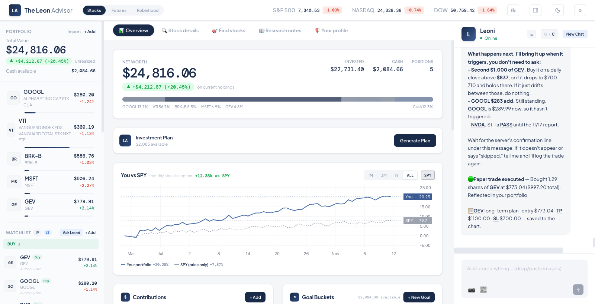

# The Leon Advisor

A personal AI investing platform: an AI stock advisor over a real portfolio, a lab of autonomous AI trading agents, and a manual futures desk with hard risk limits written in code. It runs 24/7 on a home Mac mini, and I reach it from anywhere over a private Tailscale network.

> This is a showcase repo. The source code is private.

---

## What It Does

### Leoni: AI stock advisor
- **Chat over a real portfolio.** It knows my holdings, watchlist, goals and today's prices, and answers with concrete trade calls, not vague advice.
- **Parallel research sub-agents.** Leoni sends sub-agents to research a stock, write the thesis and score the risk, using live web search and market data.
- **Investor panel.** The same idea is judged from four perspectives (Buffett, Lynch, Dalio, Wood).
- **Pre-earnings checks.** Any holding that reports within 7 days triggers a forced decision: how much has it run up, how much is at stake, and do I hold or trim.
- **An honest track record.** Every recommendation is logged with its stop and target. It's graded at 1 week, 1 month, 3 months and to date, against SPY, with ETF calls graded separately.
- **Sector screener.** It scans SPY and 14 sector ETFs to find which sectors are leading, then feeds those leads into the next chat.
- **Price alerts by Telegram**, plus a dividend tracker, net-worth chart, goal buckets, Monte Carlo projections and a weekly review.

### Autonomous AI trading agents
- **Futures agents.** Several agents with different risk profiles trade paper futures as separate processes, each with its own database. They only trade inside scheduled time windows ("kill zones").
- **Three-layer design.** Each decision runs through three layers:
  - Deterministic **risk gates** in code: daily loss limit, cooldowns, exposure, correlated positions, and no trading around economic news.
  - **Market context** given to the model as numbers: prior-day high and low, opening range, ATR, market structure.
  - **LLM judgment** limited to a few narrow steps: macro, then setup, then risk. A math engine checks the output, and code, not the model, sizes the position.
- **Agents Arena.** A dashboard where the agents compete side by side, with equity sparklines, live state, positions and logs.
- **RobinLoni.** An autonomous agent that trades a small real-money brokerage account through Robinhood's MCP tools. Her goal is to beat SPY. She works in a walled-off folder, a code-level guard blocks anything outside her rules, and I have a kill switch. Her dashboard shows her reasoning timeline, orders, research and equity against SPY.

### Backtesting & the manual desk
- **Backtest-first.** A bar-replay harness uses the same risk gates as the live agents, and no trading change merges until it passes.
- **Manual futures desk.** A charting tab I trade by hand. A server-side monitor enforces stops and targets, and a risk net that mirrors prop-firm rules stops the account from going past its drawdown limits.
- **Journal, playbook and replay.** Trade journal, daily notebook, trade replays on the chart, and reports.

---

## Screenshots

### Dashboard (early version)

---

## Stack

| Layer | Tech |
|-------|------|
| App | Next.js 16, React 19, TypeScript, Tailwind CSS |
| Data | Prisma, SQLite (one database per agent) |
| AI | Claude (Opus and Sonnet, with tool use and sub-agents), Gemini as a fallback |
| Market data | Yahoo Finance, Finnhub, a local candle store |
| Charts | TradingView Lightweight Charts |
| Integrations | Robinhood MCP, Telegram, node-cron |
| Hosting | Home Mac mini, private access over Tailscale |

---

**Built by [Sebastian Leon](https://github.com/SebastianLeonD)**
